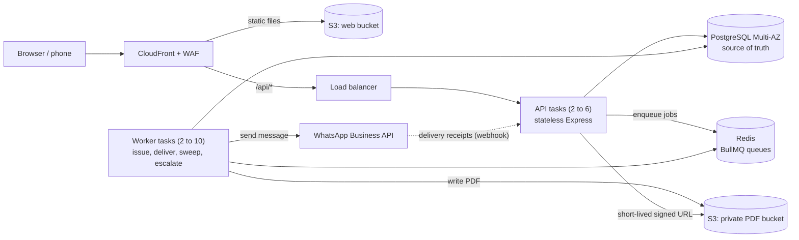

# CertiFlow: Production Deployment Plan

This is a **plan**, not something that is deployed. It covers the load from the brief:

* 100,000 registered users, about 10,000 daily active users
* Results day peak: about **500 batches approved in one hour = about 30,000 certificates (PDFs) and 30,000 WhatsApp messages**
* Public verification: thousands of lookups a day, in bursts

Honesty note: numbers marked *(estimate)* are my calculations, not measurements. Nothing here was load tested. Section 10 lists what must change in the code before this plan can really be used.

---

## 1. Architecture

**Services**

| Service | What it does | Stateless? |
|---|---|---|
| Frontend | React static files | yes (CDN) |
| API | Login, rules, approvals, verification. Only quick work | yes (JWT, no sessions) |
| Worker | Same image as the API, different command. Issues certificates, renders PDFs, sends WhatsApp, runs the one-minute maintenance job | yes |
| PostgreSQL | All business data, approval history, audit log. **The source of truth** | no |
| Redis | BullMQ job queues only. Losing it loses no business data (section 5) | no |
| S3 | Certificate PDFs, private | n/a |

**How events flow (the happy path)**

1. State officer approves. In ONE database transaction the batch becomes `APPROVED` and an audit row is written.
2. After the commit, the API adds job `issue-<batchId>` to Redis (same job id twice = ignored).
3. A worker creates one certificate per candidate (unique constraints make this repeatable) and renders each PDF to S3. It adds one job `deliver-<certificateId>` per certificate.
4. Delivery workers call WhatsApp with the certificate id as idempotency key. Failures retry with backoff.
5. The candidate opens the link, the API checks the secret token and redirects to a short-lived signed S3 URL.
6. Every minute a maintenance job escalates stuck batches and re-queues anything the database says is unfinished (the **sweeper**).

---

## 2. Where each part is hosted, and why

Region: **AWS Mumbai (ap-south-1)**. The programme is a state programme with personal data of young people: keeping data in India helps with data-residency rules and gives low latency to users. (Any cloud works; AWS is used here because the team knows it and every part below has a managed version.)

| Component | Hosting | Why |
|---|---|---|
| Frontend | S3 + CloudFront | Static files; cheap; absorbs traffic spikes without servers |
| Edge protection | CloudFront + AWS WAF | Rate limiting per IP in front of everything, blocks bad bots, hides the origin |
| API | ECS Fargate behind an Application Load Balancer | No servers to patch; scales by adding tasks; rolling deploys |
| Workers | ECS Fargate (separate service, same image) | Scale on queue depth, independent of the API |
| PostgreSQL | RDS PostgreSQL 16, **Multi-AZ**, with RDS Proxy (or PgBouncer) | Managed backups, automatic failover, point-in-time recovery. A connection pooler protects the database from many tasks |
| Redis | ElastiCache for Redis, one primary + one replica, `maxmemory-policy noeviction` | BullMQ needs no eviction. Failover in about a minute. Data is rebuildable, so durability is not critical |
| PDFs | S3 private bucket, SSE-KMS encryption | Cheap, durable, signed URLs give access control (section 6) |
| Secrets | AWS Secrets Manager | JWT secret, DB password, WhatsApp token |
| Logs / metrics | CloudWatch (+ Grafana or Sentry) | Section 7 |
| WhatsApp | An approved WhatsApp Business provider (Meta Cloud API or a partner) | Needs a verified business and approved message template |

**Environments:** `dev` (docker compose, as in the repo), `staging` (small copy of production, used for load tests and migration rehearsal), `prod`.

---

## 3. Scaling

### What scales horizontally (just add copies)

* **Frontend**: CDN.
* **API**: stateless. Autoscale 2 to 6 tasks on CPU and request count.
* **Workers**: stateless. Safe to run many copies at once because every operation is idempotent (unique constraints, job ids, provider idempotency key). Autoscale 2 to 10 tasks on **queue depth** (a custom CloudWatch metric: jobs waiting in `delivery` and `issuance`).

### What does NOT scale by adding copies

* **PostgreSQL primary**: scale up the instance, add a pooler, add indexes. Locks are **per batch row**, so different batches never block each other; only two decisions on the same batch queue up.
* **Redis primary**: scale up the node. One node handles far more than this load.

### Load maths for results day *(estimate)*

| Thing | Peak | Per second | Verdict |
|---|---|---|---|
| Approval decisions | 500 batches x about 4 decisions = 2,000 per hour | 0.6 | trivial |
| Certificates + PDFs | 30,000 per hour | 8.3 average, maybe 20 in a burst | about 60 ms CPU per PDF, so one 1-vCPU task does roughly 15 per second; 4 tasks cover bursts |
| Database writes | about 6 writes per certificate (certificate, audit, delivery status, audit) = 180,000 per hour | 50 | easy for one Multi-AZ instance |
| WhatsApp messages | 30,000 per hour | 8.3 | far below provider throughput (tens of messages per second). **The real limit is the provider's daily messaging tier and template approval**, not speed. Check the current limits with the provider and request the tier that covers 30,000+ distinct users per day |
| Page polling | 1,500 people with a page open, polling every 4 s | **375 requests/s** | **the heaviest load in the whole system.** See section 10 |
| Public verification | thousands per day, bursts maybe 100/s | 100 | one indexed lookup by certificate number; 4 API tasks are plenty |

### What limits throughput at peak, in order

1. **WhatsApp provider limits** (daily tier and per-second rate). Mitigation: BullMQ rate limiter on the delivery worker so we never exceed the allowed rate; apply for the higher tier before launch.
2. **PDF rendering CPU** (only if everything arrives in one burst). Mitigation: autoscale workers on queue depth.
3. **Polling traffic from officers' browsers.** Mitigation: server-sent events or ETag/304 responses instead of full polling, plus pagination.
4. **Database connections** (each API and worker task opens connections). Mitigation: RDS Proxy / PgBouncer and a small pool per task.

### How the backlog is cleared

Approval is instant for the officer; the work after it is a queue. At 8 to 20 certificates per second:

* 6,000 certificates (100 batches approved in a 5 minute burst): cleared in about 5 to 10 minutes.
* A full 30,000 in one hour: the queue never builds up; the last candidate gets the message minutes after the last approval.
* Delivery jobs retry independently; one slow or failing message never blocks others (10 jobs run at once per worker).
* Autoscaling rule: if the oldest waiting job is older than 2 minutes, add workers (up to 10). Scale back when the queue is empty for 15 minutes.
* Anything stuck beyond retries is marked `FAILED` and shown to the state office, who can press **Retry** (single certificate, or bulk once that button exists).

---

## 4. Failure handling

| Failure | What happens | What the user sees | What we do |
|---|---|---|---|
| **Worker crashes mid-job** | BullMQ notices the job lost its lock (about 30 seconds) and gives it to another worker. All steps are repeatable: certificates are unique per candidate, and the WhatsApp call carries an idempotency key, so a message that was already sent is not sent twice | Nothing, or a delay of under a minute | Alarm only if crashes repeat. Fargate restarts the task |
| **Redis restarts / fails over** | During the 1 to 2 minute gap the API cannot add jobs and workers pause. The API **still commits approvals** (the enqueue error is caught). When Redis returns, workers reconnect. If Redis came back **empty**, the **sweeper** (runs every minute, in the workers) finds `APPROVED` batches with no certificates and `PENDING` certificates older than 2 minutes and queues them again | Delivery is delayed, never lost | Alarm on Redis down. Fix: the sweeper currently re-queues at most 500 certificates per minute, so a total Redis loss at peak would take about an hour to recover; raise the limit (section 10) |
| **WhatsApp outage** | Each delivery fails and retries with exponential backoff. After the last attempt the certificate is marked `FAILED`, audited, and visible to the state office. Candidates can still download from the web and anyone can verify | "Failed" status on the batch page | **Production settings must be longer than the demo ones**: `WA_MAX_ATTEMPTS=10` and `WA_BACKOFF_MS=30000` gives about 4 hours of retrying before giving up (the demo default is only about 30 seconds). Add a circuit breaker that pauses the delivery queue when the failure rate is above 50 percent, so attempts are not wasted (section 10). When WhatsApp is back: bulk Retry |
| **Slow or overloaded database** | Heavy work is already asynchronous, so users mostly feel slow pages, not lost data. The queue absorbs the backlog. Connection pooler caps connections; `statement_timeout` (for example 10 s) stops runaway queries; API returns 503 instead of hanging | Slower pages | Alarm on p95 latency and CPU; scale the instance up (a few minutes with Multi-AZ); lower worker concurrency during the incident; check missing indexes with `pg_stat_statements` |
| **API task crashes mid-approval** | The approval is one transaction: it fully happens or not at all. The officer retries; the same officer repeating is harmless (idempotent) | An error, then success on retry | None |
| **Availability zone fails** | RDS fails over to the standby, ALB uses tasks in the other zone, ElastiCache promotes the replica | About 1 to 2 minutes of errors | Alarm |
| **Bad deploy** | Rolling deploy with health checks; automatic rollback if new tasks fail. Migrations are written in two steps (add, then use) so the previous version still works | None if caught | Rollback to the previous image |
| **Data corruption or deletion** | RDS automated backups with point-in-time recovery (14 days) and a monthly restore test. S3 versioning on the PDF bucket | | Documented restore runbook |

---

## 5. Why losing Redis is acceptable

The database always knows the truth: batch status, certificates, `deliveryStatus`. Redis only carries "please do this now" messages. The sweeper turns database state back into jobs. This is a deliberate design choice so that Redis does not need to be a high-durability store.

---

## 6. Certificate file storage and access control

**Today (demo):** the PDF is rendered on demand when someone downloads it and is not stored.
**Production:** the worker renders the PDF once when the certificate is issued and stores it in S3.

* Key: `certificates/<batchId>/<certificateId>.pdf`. Random ids, no personal data in the path.
* Bucket: **private**, "Block all public access" on, **SSE-KMS** encryption, versioning on, access only for the API and worker roles (least privilege IAM). Lifecycle: move to infrequent-access after 90 days; never expire without a retention decision from the programme office.
* **Candidate download:** `GET /api/public/certificates/<number>/download?token=...`. The API checks the secret token (192 bits, compared in constant time) and the certificate status, then answers with a redirect to a **signed S3 URL valid for 5 minutes**. The long-lived link in WhatsApp never exposes the bucket.
* **Staff download:** the existing PDF button; the API applies the same visibility rule as the batch (own centre, own district, quality, state), then signs a URL.
* **Cancelled certificate:** the API refuses the download (410). The object is kept for audit, not deleted.
* **Public verification** never returns the file and never returns a phone number or full name (masked name only).
* The PDF contains the candidate's name, so access is logged: S3 access logs and API audit rows.
* Size estimate: about 100 KB each, so 100,000 certificates is about 10 GB, a few dollars per month.

---

## 7. Monitoring and alerting

**Logs:** the app already writes one JSON line per event (`issued`, `delivery`, `delivery-failed`, `maintenance`, `api-started`). Ship to CloudWatch Logs; query with Logs Insights. Add a request id to every API log line and audit row so one batch or certificate can be traced end to end (the audit log already gives the business trail).

**Dashboards**

* Queues: jobs waiting, active, delayed, failed; **age of the oldest waiting job**.
* Delivery: certificates `PENDING`, `SENT`, `FAILED`; WhatsApp success rate; average attempts per certificate.
* Workflow: batches per status, batches escalated, time spent per stage.
* API: requests per second, p50 / p95 / p99 latency, 4xx and 5xx rates, 429 (rate limited) count.
* Database: CPU, connections, free storage, replica lag, slow queries.
* Redis: memory used, evictions (must be 0), connected clients, failovers.

**Alerts**

| Alert | Condition | Who |
|---|---|---|
| Queue backing up | oldest waiting job older than 5 minutes for 10 minutes | on-call engineer |
| Deliveries failing | more than 5 percent of messages in the last 15 minutes in `FAILED` or more than 50 percent attempts failing | on-call, then the state office |
| Certificates stuck | any certificate `PENDING` for more than 30 minutes | on-call |
| API errors | 5xx above 2 percent for 5 minutes, or p95 above 1.5 s | on-call |
| Database | CPU above 80 percent for 10 minutes, free storage below 20 percent, connections above 80 percent | on-call |
| Redis | down, any eviction, memory above 80 percent | on-call |
| Worker health | fewer than 2 healthy worker tasks | on-call |
| Escalated batches | any batch escalated | state office (business alert by email or message) |
| Synthetic check | `/api/public/verify/<known number>` fails from outside every minute | on-call |

Business owners also get a daily summary: batches approved, certificates sent, failed, escalated.

---

## 8. Rough monthly cost (Mumbai, in US dollars) *(estimate)*

Prices are approximate list prices and change; verify with the AWS pricing calculator before committing.

| Item | Sizing | About per month |
|---|---|---|
| RDS PostgreSQL Multi-AZ | 2 vCPU, 8 GB, 100 GB storage, backups | 330 |
| ElastiCache Redis | 2 small nodes (primary + replica) | 50 |
| ECS Fargate: API | 2 tasks of 1 vCPU / 2 GB (autoscale to 6 at peaks) | 80 |
| ECS Fargate: workers | 2 tasks baseline, up to 10 during results day | 90 |
| Load balancer | 1 ALB | 30 |
| NAT / network | 1 NAT gateway (or VPC endpoints) | 40 |
| CloudFront + WAF | static traffic + rules | 30 |
| S3 | PDFs and web files, requests | 5 |
| CloudWatch, Secrets Manager, KMS | logs, metrics, alarms | 40 |
| Sentry or Grafana | error tracking | 0 to 30 |
| WhatsApp messages | 8,000 to 30,000 per month x provider price per message (about 1 to 2 US cents) | 100 to 600 depending on volume and provider pricing |
| **Total production** | | **about 800 to 1,300** |
| Staging (smaller, can be switched off at night) | | about 150 |

**Trade-offs**

* **Cheaper, riskier (about 100 to 150 per month):** one virtual machine running the docker compose file, database on the same machine, daily backups. It works for a pilot but one failure takes everything down and results day would be tight.
* **Save about 150 by dropping Multi-AZ** on the database and Redis replica: acceptable in the first months, but then an availability zone failure means an outage and a restore.
* **Spend more for safety:** a read replica for dashboards and reports (about 150), a second region for disaster recovery (about doubles the cost).
* **WhatsApp is the biggest variable cost.** Candidates could also get an SMS fallback (not built).

---

## 9. Delivery pipeline

1. Pull request: install, type check, run **all tests** (they need Postgres and Redis service containers), build both images.
2. Merge to main: push images to ECR, deploy to staging, run a smoke test and (before results day) a load test.
3. Production: run migrations as a **one-off task before** the new version starts (today every API container runs `prisma migrate deploy` on start; with several containers a single migration job is cleaner), then rolling deploy of API and workers.
4. Migrations follow "expand then contract" (add columns, deploy, then use them, later remove) so the previous version keeps working during a deploy. The `phone` / `course` migration in this repo already follows that pattern (nullable, backfill, then not null).
5. Demo users and the demo-user dropdown are **off** in production (`DEMO_MODE=false`, no seeding). Real accounts come from the programme's identity system or an admin-created user import.

---

## 10. What must change in the code before this plan is real

These are the honest gaps between the repo today and the plan above:

1. **Store PDFs in S3 at issue time** and download through signed URLs (today: rendered on demand, nothing stored).
2. **Replace polling** (every 4 s) with server-sent events or ETag / 304 responses, and **paginate** lists. Polling is the largest request load (section 3).
3. **Rate limits use memory per API task.** Move to a Redis-backed store, and key by user for logged-in routes (many officers can share one office address).
4. **WhatsApp:** real provider adapter, delivery-receipt webhook, a BullMQ rate limiter on the delivery worker, a circuit breaker when the provider is down, and a bulk Retry button.
5. **Sweeper capacity:** it re-queues at most 500 certificates per minute; raise it or loop until empty.
6. **Health checks:** `/api/health` only says the process is alive; add a readiness check for the database and Redis.
7. **Metrics and tracing:** a metrics endpoint for queue depth and delivery counts, and a request id on every log line.
8. **Build the backend to JavaScript** (it runs with `tsx` today) and set Prisma connection pool limits.
9. **Remove demo behaviour** in production: seeding on start, shared demo password, demo-user list.
10. **Security hardening:** secrets from Secrets Manager, password reset and account management, optional multi-factor login for state and officer roles.
11. **Load test** on staging with 30,000 certificates and the polling load before results day, and measure the real PDF rate (the 15 per second per task above is an estimate).

None of these change the core design: database as the source of truth, idempotent background work behind a queue, and unique constraints as the last line of defence.
